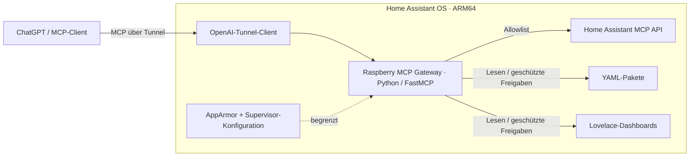

<div align="center">

# Raspberry MCP Gateway

### Connect AI to your Smart Home. Securely.

**Ein Python-basiertes MCP-Gateway für die kontrollierte Verbindung von ChatGPT und Home Assistant.**  
Ein Tunnel. Klar definierte Berechtigungen. Nachvollziehbare Änderungen.

[](openai_mcp_tunnel/config.yaml)
[](https://www.home-assistant.io/)
[](#installation-und-selbstbau)
[](openai_mcp_tunnel/Dockerfile)
[](LICENSE)
[](#projektstatus)

**[Funktionen](#funktionen)** · **[Architektur](#architektur)** · **[Security by Design](#security-by-design)** · **[Installation](#installation-und-selbstbau)** · **[Engineering & CI](#engineering--ci)**

</div>

---

## Die Idee

Ein Smart Home mit KI zu verbinden ist technisch einfach. **Den Zugriff dabei sicher, überprüfbar und wartbar zu gestalten, ist die eigentliche Architekturaufgabe.**

Raspberry MCP Gateway verbindet einen OpenAI-Tunnel mit einem lokalen Gateway auf **Home Assistant OS**. Über das **Model Context Protocol (MCP)** stehen ausgewählte Home-Assistant-Funktionen sowie zusätzliche lokale Diagnose-, Dashboard- und YAML-Werkzeuge zur Verfügung.

Statt einer offenen Allzweck-Schnittstelle setzt das Projekt auf **Least Privilege**, explizite Freigaben und nachvollziehbare Änderungen. Im Mittelpunkt steht keine möglichst große Funktionsliste, sondern eine kontrollierbare Integration.

## Funktionen

| Baustein | Umsetzung |
| --- | --- |
| 🔌 **AI × Smart Home** | Verbindung von ChatGPT und Home Assistant über einen einzelnen MCP-Tunnel. |
| 🧭 **Kontrollierter HA-Zugriff** | Der HA-MCP-Proxy beschränkt weitergeleitete Upstream-Werkzeuge auf eine explizite Allowlist. |
| 📄 **YAML Guard** | Lesender Zugriff und geschützte Änderungen unter `/config/packages/` mit Vorschau, Diff, SHA256-Bindung und Backups. |
| 🖥️ **Dashboard-Werkzeuge** | Übersicht, Diagnose und gesondert abgesicherte Änderungs- und Wiederherstellungsabläufe für Lovelace-Dashboards. |
| 🛡️ **AppArmor & Berechtigungen** | Eingeschränkte Dateipfade, Sicherheitsprüfungen und standardmäßig deaktivierte Schreibfunktionen. |
| ♻️ **Recovery & Wartung** | Gezielte Backup-, Vorschau- und Wiederherstellungsfunktionen mit separaten Freigaben. |

**Bewusste Grenze:** Nicht jede Funktion ist automatisch zum Schreiben berechtigt. Die meisten Abläufe sind zunächst lesend oder liefern nur einen überprüfbaren Änderungsvorschlag.

## Architektur



**Architekturprinzipien**

- **Ein Gateway, ein Tunnel:** keine zweite parallel aktive Tunnelinstanz.
- **Separation of concerns:** Tunneltransport, HA-Proxy und lokale Verwaltungswerkzeuge erfüllen getrennte Aufgaben.
- **Fail closed:** Fehlende, ungültige oder nicht passende Freigaben sollen Schreiboperationen verhindern.
- **Standardwerkzeuge statt Eigenbau:** Python/pip, Alpine/apk und Docker/BuildKit übernehmen Abhängigkeitsverwaltung und Image-Builds.
- **Keine Geheimnisse im Repository:** Zugangsdaten werden ausschließlich in der lokalen Home-Assistant-App-Konfiguration hinterlegt.

## Security by Design

Sicherheit wird nicht nur in der Dokumentation beschrieben, sondern in mehreren Ebenen umgesetzt:

| Schutzschicht | Mechanismus |
| --- | --- |
| **MCP-Werkzeugauswahl** | Beschränkte Weiterleitung ausgewählter HA-Upstream-Werkzeuge. |
| **Schreibzugriffe** | `MCP_WRITE_ENABLED=false` als sichere Standardvorgabe. |
| **Einzelfreigaben** | Aktionsbezogene Freigabewerte; bei geschützten Dateioperationen an den geprüften SHA256-Zustand gebunden. |
| **Dateisystem** | Auf erlaubte Bereiche eingegrenzte Anwendungsgates und AppArmor-Regeln. |
| **Nachvollziehbarkeit** | Diff- und SHA256-Vorschau vor Änderungen; vorhandene Sicherungs- und Rückfallmechanismen. |
| **Supply Chain** | Festgelegte Basisimage-Digests, Paket-Lockdateien und ARM64-Buildprüfungen. |

**Wichtige technische Grenze:** Das Home-Assistant-Konfigurationsverzeichnis ist für die App technisch schreibbar eingebunden. Die tatsächliche Beschränkung hängt daher von der geladenen AppArmor-Policy und den Anwendungsgates ab; `MCP_WRITE_ENABLED=false` ersetzt auch keine eingeschränkten Rechte des verwendeten Home-Assistant-Tokens.

Details zu Sicherheitsgrenzen, Restrisiken und dem Umgang mit Schwachstellen: **[SECURITY.md](SECURITY.md)**.

## Technologie-Stack

| Ebene | Technologien |
| --- | --- |
| **Gateway / MCP** | Python 3.15, FastMCP, YAML-Verarbeitung |
| **Smart-Home-Plattform** | Home Assistant OS, Supervisor, Lovelace |
| **Container & Betrieb** | Docker / BuildKit, Alpine Linux, ARM64, AppArmor |
| **Abhängigkeiten** | pip mit Hash-Pinning, apk mit Paketversionen und Checksummen |
| **Qualitätssicherung** | Python `unittest`, GitHub Actions, native ARM64-Buildjobs |
| **Supply-Chain-Prüfung** | Syft / SPDX-SBOM, Grype-CVE-Scan, dokumentierte Risikoentscheidungen |

## Engineering & CI

Die Entwicklung findet in einem **privaten Entwicklungsrepository** statt. Dieses öffentliche Repository enthält einen bewusst begrenzten, zur Veröffentlichung geprüften **Quellcode-Snapshot** – keine private Git-Historie, keine Zugangsdaten und keine internen Testartefakte.

Der Entwicklungsprozess verwendet:

1. **Pull-Request-basierte Änderungen** mit nachvollziehbaren Commits und Regressionstests.
2. **Offline-Tests und Syntaxprüfungen** in GitHub Actions (mehr als 280 Tests im dokumentierten Entwicklungsstand).
3. **Native ARM64-Builds** mit Docker/BuildKit statt eigener Download- und Paketverwaltung.
4. **Software Bill of Materials (SBOM)** im SPDX-Format und Schwachstellenprüfung mit Grype.
5. **Dokumentierte Restrisikoentscheidungen**, statt CVE-Meldungen pauschal zu unterdrücken.

Die genannten CI-Prüfungen stammen aus dem privaten Entwicklungsprozess. **Dieses öffentliche Snapshot-Repository bietet derzeit keinen eigenständigen öffentlichen CI-Status-Badge.** Ein bestandener Offline-Test ersetzt keine vollständige HAOS- oder Sicherheitsabnahme.

## Installation und Selbstbau

### Voraussetzungen

- Home Assistant OS mit Supervisor auf **ARM64 / `aarch64`**.
- Erreichbarer interner Home-Assistant-MCP-Endpunkt und ein geeignet eingeschränktes HA-Zugriffstoken.
- Gültige Tunnel-Zugangsdaten.
- Netzwerkzugriff auf die im Dockerfile festgelegten offiziellen Bezugsquellen während des Builds.
- Ein **geprüftes Backup** und ein Rückfallweg vor dem produktiven Austausch einer bestehenden Installation.

### Home-Assistant-App-Repository

Das Repository enthält die Home-Assistant-App im Verzeichnis `openai_mcp_tunnel/` sowie die Metadatei `repository.yaml`.

Repository-Adresse:

```text
https://github.com/keanuutah/raspberry-mcp-gateway-public
```

In Home Assistant: **Einstellungen → Apps → App-Store → Repositories** und die URL hinzufügen, sofern sie noch nicht vorhanden ist. Anschließend die App **Raspberry MCP Gateway** auswählen. Bei der erstmaligen Installation **nicht starten**, bevor die Konfiguration geprüft ist.

> Die App ist aktuell als **Experimental** markiert. Der bereits nachgewiesene Betrieb auf einer privaten HAOS-Installation ist keine allgemeine Freigabe für fremde Produktionssysteme. Installation und Betrieb erfolgen eigenverantwortlich unter Beachtung der dokumentierten Sicherheitsgrenzen.

### App-Konfiguration

| Option | Bedeutung / Empfehlung |
| --- | --- |
| `CONTROL_PLANE_TUNNEL_ID` | Eigene Tunnelkennung; nur lokal eintragen. |
| `CONTROL_PLANE_API_KEY` | Tunnel-Schlüssel; niemals veröffentlichen. |
| `MCP_SERVER_URL` | Interner HA-MCP-Endpunkt; nur die im Launcher zugelassenen lokalen Adressen verwenden. |
| `HA_ACCESS_TOKEN` | HA-Zugangstoken mit minimal benötigten Rechten. |
| `MCP_WRITE_ENABLED` | Standardmäßig `false`. |
| `APPROVED_ACTION` | Standardmäßig leer; Einmalfreigaben nicht wiederverwenden. |
| `BACKUP_RETENTION_MODE` | Standardmäßig `off`. |

Die App ist mit `boot: manual`, `apparmor: true` und `stage: experimental` definiert. **Keine zweite Instanz mit denselben Tunnel-Zugangsdaten parallel starten.**

### Image separat mit Docker bauen

Für einen eigenen, ARM64-fähigen Docker-Builder aus dem Repository-Root:

```bash
docker build --platform linux/arm64 \
  --tag raspberry-mcp-gateway:local-review \
  ./openai_mcp_tunnel
```

Dieser Befehl baut **nur das Container-Image**. Er installiert oder startet keine Home-Assistant-App. Das Repository veröffentlicht **kein vorgebautes OCI-/GHCR-Image**. Für Builds werden gepinnte Basisimages sowie die Dateien `apk-arm64.lock` und `requirements-arm64.lock` verwendet.

## Projektstatus

| Thema | Stand |
| --- | --- |
| **v1.1.0 auf ARM64/HAOS** | Läuft in einer privaten Home-Assistant-Installation; Tunnel und lesende MCP-/Gateway-Funktionen wurden praktisch bestätigt. |
| **AppArmor** | Die derzeit laufende v1.1.0 meldete `enforce`; die GitHub-Profilzuordnung war noch nicht bestätigt. Die korrigierte Profilnamen-Diagnose ist als v1.1.1 im öffentlichen Quellcode enthalten und wurde in privater CI getestet; die Live-Nachprüfung nach dem Update steht noch aus. |
| **CVE-Status** | Im letzten nativen ARM64-Scan: **0 Critical**, **9 unterschiedliche High-CVEs** (14 Pakettreffer). Die High-Risiken sind einzeln bewertet und unter dokumentierten Bedingungen akzeptiert; es waren keine geeigneten Stable-Fixversionen verfügbar. Kein offizieller Gate-PASS für den zuletzt veröffentlichten Image-Stand nachgewiesen. |
| **Automatisierte Tests** | Reguläre private CI und gezielte Regressionstests erfolgreich; keine allgemeine HAOS-Laborabnahme. |
| **Öffentliche Bereitstellung** | Quellcode und HAOS-App-Metadaten, **kein vorgebautes Container-Image**. |
| **Release-Einstufung** | `experimental` – keine allgemeine Produktionsfreigabe. |

**Transparenz:** Die erfolgreiche private Inbetriebnahme ist ein Praxistest, keine vollständige, unabhängige Sicherheitszertifizierung. Offene Prüfungen werden nicht als bestanden dargestellt; bekannte CVEs und Sicherheitsgrenzen bleiben gesondert dokumentiert.

## Weiterentwicklung

Der Fokus liegt auf einer einfachen, sicheren und wartungsarmen Integration. Weitere Verbesserungen betreffen insbesondere die abschließende AppArmor-Profilverifikation auf GitHub-installierten Apps, die Release-Nachweise und die technische Dokumentation. Änderungen sollen bestehende Betriebsabläufe verbessern, statt parallele Systeme aufzubauen.

## Lizenz und Verantwortung

Der eigene, entsprechend gekennzeichnete Projektquellcode wird unter **[Apache License 2.0](LICENSE)** veröffentlicht, soweit die erforderlichen Rechte vorliegen. Externe Komponenten – darunter Home Assistant, FastMCP, Python, Alpine und der Tunnel-Client – behalten ihre jeweiligen Lizenzen und Markenrechte. Das Projekt ist **keine offizielle Veröffentlichung von Home Assistant oder OpenAI**.

Für Sicherheitsmeldungen die dokumentierten Wege zur vertraulichen Offenlegung verwenden. Bitte niemals Zugangsdaten oder private Home-Assistant-Konfigurationen in öffentlichen Issues posten.

---

<div align="center">

**Built for maintainability. Designed for controlled AI access.**

Python · MCP · Home Assistant · ARM64 · Security by Design

</div>